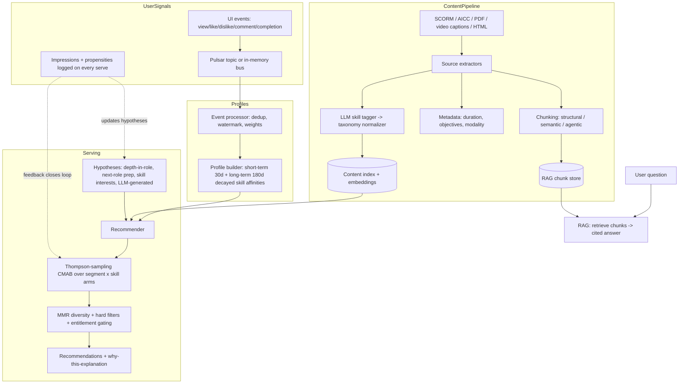

# Recommender Platform

[](https://github.com/hari2353/recommender-platform/actions/workflows/ci.yml)

An open-source, hypothesis-driven learning recommendation platform: UI signals stream through a
message bus into decaying skill-affinity profiles, an **LLM-tagged content intelligence pipeline**
ingests courses from any format (SCORM/AICC/PDF/video-transcript/HTML), and a two-stage recommender
retrieves via skills + embeddings then ranks with **contextual bandits over explainable hypotheses**.
Includes **document RAG** over ingested course content with semantic/agentic chunking.

Part of the [skills-engine](https://github.com/hari2353/skills-engine) stack.

## Architecture



## The hypothesis layer (what makes this different)

Instead of a black-box ranker, every recommendation serves an explicit **hypothesis** about the learner:

| Type | Example | Source |
|---|---|---|
| `depth_in_role` | "wants to deepen current-role expertise" | role ladder |
| `next_role_prep` | "preparing for platform_engineer; gaps: K8s, AWS" | role ladder gap analysis |
| `skill_interest` | "shows interest in Kubernetes" | observed interactions |
| LLM-generated | free-form strategies from signal summaries | optional OpenAI-compatible endpoint |

Each hypothesis carries a Beta(α,β) posterior updated by like/dislike/no-click feedback. Thompson sampling
picks which hypothesis serves each request (with an ε-greedy floor so starving arms still explore);
weak ones (`mean < 0.30` after ≥10 pulls) are **retired automatically**. `GET /v1/hypotheses/{user_id}`
exposes the full belief state — recommendations you can audit.

## Content intelligence pipeline

`POST /v1/content-events` accepts lifecycle events (`course.created/updated/deleted`) carrying any source type:

- **SCORM**: `imsmanifest.xml` title/objectives parsing
- **AICC**: `.crs` course blocks
- **PDF**: text extraction (pdfminer)
- **Video/captions**: SRT/VTT transcript parsing
- **HTML**: script/style-stripped extraction

Each item is tagged with taxonomy skills (LLM when configured, gazetteer fallback), enriched with metadata
(modality, estimated duration at 130 wpm, objectives), embedded, and chunked for RAG using
**structural**, **semantic** (embedding-drift boundaries), or **agentic** (LLM-decided) strategies.
Out-of-order delivery is handled by monotonic `content_version` checks; deletes remove items and chunks immediately.

## Embeddings

| Provider | Env | Notes |
|---|---|---|
| hashing (default) | `RECSYS_EMBEDDING_PROVIDER=hashing` | offline, instant, deterministic |
| E5 multilingual large | `=e5` | open weights, query/passage prefixes, needs model download |
| MiniLM multilingual | `=multilingual_st` | lighter CPU option |
| Titan Embed v2 | `=titan` | AWS Bedrock, 512-dim normalized |

## Quickstart

```bash
pip install -r requirements.txt
uvicorn recsys.api.app:app --reload --port 8020

curl -X POST localhost:8020/v1/events -H "Content-Type: application/json" \
  -d '{"events":[{"event_id":"e1","user_id":"u1","type":"view","content_id":"c008","dwell_ms":300000}]}'

curl "localhost:8020/v1/users/u1/recommendations?role=platform_engineer&k=3"
curl -X POST localhost:8020/v1/feedback -d '{"recommendation_id":"...","content_id":"c009","action":"like","user_id":"u1"}' -H "Content-Type: application/json"
```

## Serving + eval hygiene (market-steal, 2026-11-18)

- **Serving fatigue controls** — `completion` events now hard-filter the
  item for that user (same path as dislike, permanent + idempotent), and
  `serve()` applies a repeat cooldown: items served ≥
  `repeat_serve_limit` (default 3) times are demoted, with a top-up rule
  so the slate is never short.
- **Ranking metrics** (`recsys/eval/ranking.py`) — `precision_at_k`,
  `recall_at_k`, `mrr`, `ndcg_at_k`, `hit_rate_at_k` for retrieval evals.
- **Off-policy eval hardening** (`recsys/eval/ips.py`) — `snips_estimate`
  (self-normalized), `effective_sample_size`, and `compare_policies`
  producing per-policy `{ips, snips, ess}` on the same impression log.
curl -X POST localhost:8020/v1/rag/query -d '{"question":"How do consumer groups work?"}' -H "Content-Type: application/json"

python scripts/simulate_traffic.py    # seeded demo: watch CTR climb as bandits learn
```

Sample output (seed 42, 140 rounds × 3 personas — seeded, so these reproduce exactly):

```
sim-platform: CTR 0.483 -> 0.683 (+41.4% uplift)   # k8s/aws interest discovered via exploration slot
sim-data:     CTR 0.565 -> 0.730 (+29.2% uplift)   # depth + LLM interest hypotheses both kept
sim-ml:       CTR 0.105 -> 0.083 (-21.2% uplift)   # known limitation: cross-role discovery still weak
```

We show all three lines on purpose: two personas improve as hypotheses get validated; the third exposes a real,
documented gap (cross-role serendipity needs the item-side exploration budget tuned — see `ARCHITECTURE.md`).
Honest evals beat cherry-picked demos.

Optional real infrastructure: `docker compose up -d` (Pulsar + Redis), then `RECSYS_BUS=pulsar`.
Default bus is in-memory with an identical interface — full demo value at $0.

## Scoring & learning

- Event weights: view 1.0 · completion 2.5 · like 3.0 · comment 4.0 · dwell bonus up to +25%
- Dislike = hard filter on the item + negative reward to its arm + hypothesis penalty
- Impression without click resolves as weighted-negative after 24h
- Per-user normalization prevents power-user domination; exponential decay (30d short-term / 180d long-term)
- Day zero: role-ladder seeding + elevated exploration; daily upgrades as posteriors sharpen
- Offline policy evaluation via IPS over logged propensities (`recsys.eval.ips`)

## Tests

55 tests cover dedup/watermarks, decay math, tier filtering, reranker blending, Thompson convergence,
hypothesis weeding, chunkers (all three strategies), RAG citations, entitlement gating, GDPR delete,
and the full HTTP loop: events → profile → recommendations → feedback → hardened next serve.

MIT
